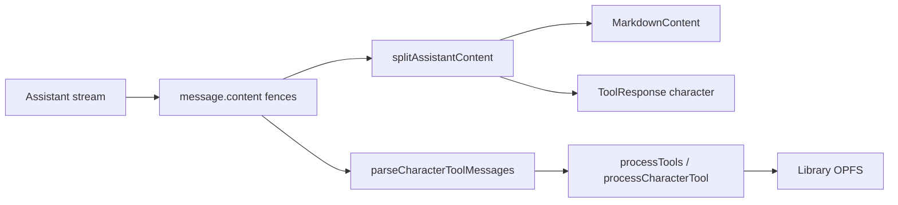

# MatchDate — Quote tool (spoken dialogue in chat)

> **Purpose:** Spec for a display-only `quote` tool so character speech appears as structured chat chrome (thumbnail + name + line), not only as prose. Adapted from the existing fenced-tool pipeline in `MD-tools.md`.

**Last updated:** 2026-11-01  
**Status:** Phase A shipped — types/parse/split + QuoteBubble + prompt; Phase B (click-through / TTS) not started.  
**Related:** [`MD-tools.md`](./MD-tools.md), [`MD-Chat-Feature.md`](./MD-Chat-Feature.md), [`MD-audio.md`](./MD-audio.md), [`prompts/prompt-matchDate.md`](../prompts/prompt-matchDate.md), [`src/components/library/LibraryList/LibraryCharacterThumb.tsx`](../src/components/library/LibraryList/LibraryCharacterThumb.tsx)

---

## 0. TL;DR

| Item | Choice |
|------|--------|
| **Tool** | `quote` |
| **Origin / action** | `origin: "agent"`, `action: "display"` |
| **Data** | `{ quote, speaker, speakerName }` |
| **Envelope `id`** | Quote instance GUID (model may omit; app stamps if missing) |
| **Library side effects** | **None** — display-only; not routed through `processCharacterTool` |
| **Prose rule** | Markdown = narration / action only; **spoken lines live only in quote tools** (no `John: Hello` duplicated in prose) |
| **UI** | QuoteBubble: character thumb, name underneath, quote text beside/below |
| **Build order** | Phase A: types + parse/split + QuoteBubble + prompt · Phase B: click-through, TTS hook |

**Example turn shape (conceptual):**

```
John and Sara are talking.
[quote tool — John — "The weather is nice today."]
[quote tool — Sara — "It really is."]
They order coffee.
```

---

## 1. Purpose

MatchDate chat already uses fenced JSON tools for **character** attach / update / create. Spoken dialogue today is plain markdown (`John: Hello`), which:

- Cannot show a stable character thumbnail next to the line
- Is awkward for future per-line TTS / multi-speaker audio ([`MD-audio.md`](./MD-audio.md) §3.1a)
- Blurs narration vs speech for the reader

The **quote** tool makes each spoken turn a first-class, interleaved block in the assistant message.

**Out of scope for v1:** persisting quotes outside `message.content`, accept/reject gates, OPFS assets for quotes, multi-speaker TTS wiring (hook only).

---

## 2. Architecture review (today)

### 2.1 Pipeline



| Layer | Today | Quote impact |
|-------|--------|--------------|
| Envelope | [`jsonAttach.ts`](../src/features/chat/attach/jsonAttach.ts) — `CHARACTER_TOOL` only | Add `QUOTE_TOOL` + `QuoteToolMessage` |
| Parse | [`parseCharacterTools.ts`](../src/features/chat/attach/parseCharacterTools.ts) — character filter | Add `isQuoteToolMessage` / parse alongside character (or a shared `parseToolMessages`) |
| Split / UI | [`splitAssistantContent.ts`](../src/utils/splitAssistantContent.ts) only lifts **character** fences; other ` ```json ` blocks stay in markdown | Treat `quote` fences as tool (or `quote`) blocks |
| Render | [`AssistantMessageContent.tsx`](../src/components/message/AssistantMessageContent/AssistantMessageContent.tsx) → [`ToolResponse.tsx`](../src/components/chat/ToolResponse/ToolResponse.tsx) | New **QuoteBubble** (not the collapsible character ToolResponse chrome) |
| Apply | [`MessageComposerContainer`](../src/features/chat/containers/MessageComposerContainer.tsx) `onDone` → `processTools` for agent `update` / `create` | Quotes **ignored** by processors (render-only) |
| Prompt | [`prompts/prompt-matchDate.md`](../prompts/prompt-matchDate.md) | New section: when / how to emit quotes |

### 2.2 Contrast with character tools

| | `character` | `quote` |
|--|-------------|--------|
| Purpose | Mutate / propose library sheets | Display spoken dialogue |
| Actions | `write` / `update` / `create` / `read` | `display` only |
| Apply | Updates auto-apply; creates gated | Never applies to library |
| UI | Collapsible “Updated Name” + JSON | Always-visible QuoteBubble |
| `id` | Character UUID (create omits until accept) | Quote instance UUID |

Character tools remain the source of truth for sheets. Quotes only **reference** a character via `data.speaker`.

### 2.3 Gaps to close

1. Tool registry / types for `quote` (envelope + data).
2. `splitAssistantContent` must recognize `quote` fences (streaming + complete), not only `character`.
3. Dedicated QuoteBubble using [`LibraryCharacterThumb`](../src/components/library/LibraryList/LibraryCharacterThumb.tsx).
4. Prompt rules so the model emits quotes instead of `Name: line` prose.
5. Ensure `processTools` never treats quote envelopes as character failures (filter by `tool` before route).

---

## 3. Wire format

Tools travel as fenced JSON inside assistant `content` (same transport as character tools):

````markdown
```json
{ ...QuoteToolMessage... }
```
````

### 3.1 Envelope + data

```ts
export const QUOTE_TOOL = 'quote' as const;

export type QuoteToolOrigin = 'agent'; // v1: agent-emitted only
export type QuoteToolAction = 'display';

export interface QuoteToolData {
  /** Spoken line only — no speaker prefix, no stage directions. */
  quote: string;
  /** Character document GUID when known (from user `write` attach or prior create accept). */
  speaker?: string;
  /** First / display name for chrome and fallback when thumb unavailable. */
  speakerName: string;
}

export interface QuoteToolMessage {
  tool: typeof QUOTE_TOOL;
  origin: QuoteToolOrigin;
  action: QuoteToolAction;
  /** Quote instance GUID. Optional from the model; app stamps if missing. */
  id?: string;
  data: QuoteToolData;
}
```

### 3.2 Example

Narration in markdown, then a quote fence:

````markdown
John and Sara are talking.

```json
{
  "tool": "quote",
  "origin": "agent",
  "action": "display",
  "id": "a1b2c3d4-e5f6-7890-abcd-ef1234567890",
  "data": {
    "quote": "The weather is nice today.",
    "speaker": "11111111-2222-3333-4444-555555555555",
    "speakerName": "John"
  }
}
```

```json
{
  "tool": "quote",
  "origin": "agent",
  "action": "display",
  "data": {
    "quote": "It really is.",
    "speaker": "aaaaaaaa-bbbb-cccc-dddd-eeeeeeeeeeee",
    "speakerName": "Sara"
  }
}
```

They walk toward the cafe.
````

### 3.3 Validation rules

| Field | Rule |
|-------|------|
| `tool` | Must be `"quote"` |
| `origin` | `"agent"` (v1) |
| `action` | `"display"` |
| `id` | UUID string if present; if absent, app generates for React keys / future TTS |
| `data.quote` | Required; non-empty after trim; **no** `"John: "` prefix |
| `data.speakerName` | Required; non-empty (prefer first name) |
| `data.speaker` | Required when the speaker is an attached library character (`write` id); optional for unnamed / not-yet-accepted creates (name-only chrome) |

Invalid or incomplete fences while streaming: show a streaming QuoteBubble skeleton when `"tool":"quote"` is detected; do not fall back to dumping raw JSON in markdown once recognized.

---

## 4. Prompt rules (for `prompt-matchDate.md`)

Add a dedicated section (implement in Phase A). Intent:

### When to emit

- Whenever a **character speaks** dialogue in the scene, emit **one** `quote` tool per spoken turn.
- Multiple speakers in one reply → multiple quote fences, interleaved with narration markdown.

### What goes where

| Content | Where |
|---------|--------|
| Scene, action, body language, “they walk…” | Markdown prose |
| Spoken words | `data.quote` only |
| Who is speaking | `data.speaker` + `data.speakerName` |

**Do not** also write `John: "…"` (or equivalent) in prose when a quote tool covers that line.

### IDs and names

- `speaker` = the same character UUID from the user’s `character` / `write` attach (or a create that the user already accepted and that appears in context).
- `speakerName` = first name (or short display name) for UI.
- Envelope `id` may be omitted; if the model invents one, it must be a fresh UUID per quote (never reuse a character id as the quote `id`).

### Quote text hygiene

- Spoken line only; no tool/meta language (“as an AI”, “ValueScore”, etc.) — same “hide the mechanics” rule as the rest of the prompt.
- Keep lines conversational length; split long monologues into multiple quote tools if needed.
- Inline performance belongs in future TTS style / tags — not required in v1 quote `data`.

### Coexistence with character tools

- Same reply may include narration + quotes + `character` / `update` or `create` fences.
- Quotes do **not** replace history/trait updates; history summaries stay on character tools.

---

## 5. UI — QuoteBubble

### 5.1 Layout

One composition per quote block:

```
┌────────┬──────────────────────────────┐
│ [thumb]│  "The weather is nice today."│
│  John  │                              │
└────────┴──────────────────────────────┘
```

- **Thumb:** [`LibraryCharacterThumb`](../src/components/library/LibraryList/LibraryCharacterThumb.tsx) when `speaker` is a known character id; else placeholder (`Icon` character / generic).
- **Name:** under the thumb (`speakerName`).
- **Quote:** primary text; use quotation styling consistent with chat typography (not a nested ToolResponse caret/JSON panel).

### 5.2 Rendering path

1. [`splitAssistantContent`](../src/utils/splitAssistantContent.ts) yields blocks: `markdown` | `tool` (character) | `quote` (or `tool` with `tool === 'quote'` + parsed data).
2. [`AssistantMessageContent`](../src/components/message/AssistantMessageContent/AssistantMessageContent.tsx) switches:
   - `character` → existing `ToolResponse`
   - `quote` → `QuoteBubble`
   - else → `MarkdownContent`

### 5.3 Streaming

- Unclosed fence with `"tool":"quote"` → QuoteBubble `complete: false` (muted / skeleton thumb, partial quote if regex-extractable).
- On fence close + valid JSON → finalize.

### 5.4 Fallbacks

| Situation | UI |
|-----------|-----|
| Missing / unknown `speaker` | Name + placeholder thumb |
| Empty `quote` after trim | Skip block or show error chrome (prefer skip) |
| Thumb load failure | Same placeholder as library list |

### 5.5 Interaction (Phase B)

- Optional: click thumb/name → navigate to `/character/:speaker`.
- Optional: Play affordance → future TTS using character voice ([`MD-audio.md`](./MD-audio.md)).

---

## 6. Implementation phases

```
Phase 0 (this doc) ──► Phase A ──► Phase B
spec                   ship quotes     polish / TTS hook
```

### Phase A — Ship quotes (first implementation) ✅

- [x] Types: `quoteAttach.ts` — `QUOTE_TOOL`, `QuoteToolMessage`, `QuoteToolData`
- [x] Parse: `parseQuoteTools.ts` — `isQuoteToolMessage` / `normalizeQuoteToolMessage`; stable id if missing
- [x] Split: `splitAssistantContent` lifts quote fences (complete + streaming)
- [x] UI: `QuoteBubble` + wired in `AssistantMessageContent`
- [x] Apply path: `parseCharacterToolMessages` only; `processTools` ignores non-character
- [x] Prompt: quote section in `prompts/prompt-matchDate.md`
- [x] Tests: parse + split fixtures

**Exit:** Assistant replies can interleave narration + QuoteBubbles; character update/create still work.

### Phase B — Polish

- Click-through to character sheet.
- Optional TTS play on a quote (single-speaker Gemini path first).
- Prompt tuning if models still duplicate dialogue in prose.

### Explicitly deferred

- Persisting quotes as library assets or separate OPFS docs.
- Multi-speaker `speakers[]` TTS for a run of quotes ([`MD-audio.md`](./MD-audio.md) §3.1a).
- User-origin quotes (`origin: "user"`).

---

## 7. Spec decisions (locked for v1)

| Decision | Choice |
|----------|--------|
| Tool name | `quote` |
| Action | `display` only |
| Persistence | Message content fences only |
| Prose vs speech | Narration in markdown; speech **only** in quote tools |
| Character linkage | `data.speaker` = character GUID; `speakerName` for chrome |
| Quote `id` | Instance GUID; app stamps if model omits |
| Character ToolResponse UI | Unchanged for `character` tools |
| `processTools` | Character only; quotes never apply |

---

## 8. File touch list (Phase A implementers)

| Area | Paths |
|------|--------|
| Types / builders | `src/features/chat/attach/jsonAttach.ts` (or new `quoteAttach.ts`) |
| Parse | `src/features/chat/attach/parseCharacterTools.ts` → extend or sibling `parseQuoteTools.ts` / shared parser |
| Split | `src/utils/splitAssistantContent.ts` (+ tests) |
| UI | `src/components/chat/QuoteBubble/*` (new); `AssistantMessageContent.tsx` |
| Thumb reuse | `src/components/library/LibraryList/LibraryCharacterThumb.tsx` |
| Apply | `src/services/tools/processTools.ts` / composer `onDone` — ensure quotes skipped |
| Prompt | `prompts/prompt-matchDate.md` |
| Docs | This file; brief cross-link from `MD-tools.md` § tool extensibility |

---

## 9. Sources / related

- Tool envelope protocol: [`MD-tools.md`](./MD-tools.md)
- Chat streaming / messages: [`MD-Chat-Feature.md`](./MD-Chat-Feature.md)
- Live system prompt: [`prompts/prompt-matchDate.md`](../prompts/prompt-matchDate.md)
- Future speech: [`MD-audio.md`](./MD-audio.md) §3.1a multi-speaker research
- Character thumb: [`LibraryCharacterThumb.tsx`](../src/components/library/LibraryList/LibraryCharacterThumb.tsx)
